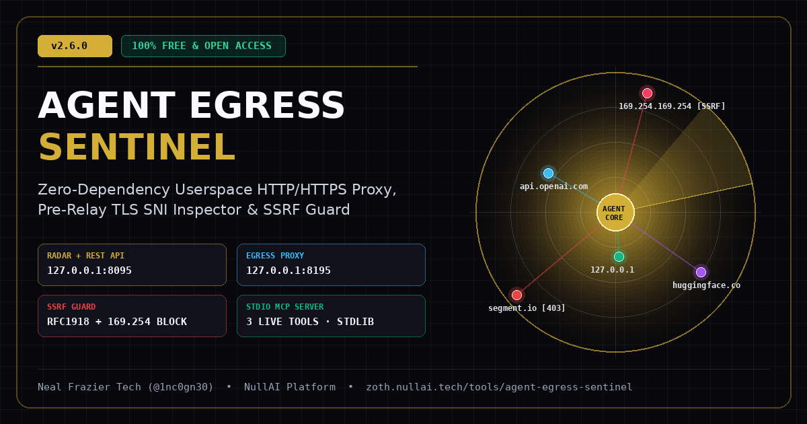

# Agent Egress Sentinel (`v2.6.0`)



**Agent Egress Sentinel** (`agent-egress-sentinel`) is a zero-dependency Python 3.9+ userspace HTTP/HTTPS `CONNECT` egress proxy (`127.0.0.1:8195`), in-memory TLS ClientHello SNI inspector, SSRF/private-network guard, stdio MCP server, and real-time domain radar (`127.0.0.1:8095`) for AI agents and LLM runtimes.

- **Zoth Studio v2 Route**: [https://zoth.nullai.tech/tools/agent-egress-sentinel](https://zoth.nullai.tech/tools/agent-egress-sentinel)
- **Repository**: [https://github.com/1nc0gn30/agent-egress-sentinel](https://github.com/1nc0gn30/agent-egress-sentinel)
- **Loopback Endpoints**: Web Radar `http://127.0.0.1:8095` • Egress Proxy `http://127.0.0.1:8195`

---

## What It Does

- **Userspace HTTP & HTTPS `CONNECT` Proxy (`127.0.0.1:8195`)**: Intercepts outbound traffic from any AI runtime without installing root CA certificates, logging destination domains, status codes, byte volumes, and latency into SQLite WAL.
- **Pre-Relay TLS ClientHello SNI Inspection**: Parses SNI hostnames in memory and re-evaluates `RulesEngine.is_allowed(sni_domain)` **before** relaying TLS handshake bytes upstream, blocking SNI fronting attempts.
- **SSRF & Self-Control-Plane Protection**: Resolves DNS with pinned connections and blocks RFC1918 (`10/8`, `172.16/12`, `192.168/16`), cloud metadata / link-local (`169.254.0.0/16`, `fe80::/10`), IPv6 ULA (`fc00::/7`), and Sentinel's own loopback ports (`127.0.0.1:8095`, `127.0.0.1:8195`) by default—even under `zero_egress`.
- **4 Quarantine Modes & Live Rule Editor**: `allow_all`, `block_telemetry`, `zero_egress`, and `allowlist_only`, plus live allowlist/blocklist editing (`POST`/`DELETE` `/api/rules/*`) with wildcard support (`*.telemetry.example.com`).
- **Dual-Theme Radar & HAR 1.2 / OpenAPI 3.0 Export**: Editorial Ivory Light Mode and Obsidian Dark Mode (`?theme=light|dark`, `?embed=1`), live SSE stream, and instant HAR 1.2 / OpenAPI 3.0 synthesis.

---

## How It Works

```text
Agent Process (HTTP_PROXY / HTTPS_PROXY -> 127.0.0.1:8195)
        │
        ▼
EgressProxy (:8195) ──► DNS Pinning + SSRF Guard + Pre-Relay TLS SNI Check
        │                    └── RulesEngine (allow_all | block_telemetry | zero_egress | allowlist_only)
        ▼
EgressCollector (SQLite WAL) ──► Web Radar (:8095) + SSE (/api/stream) + Stdio MCP + Live TUI
```

### Security Controls
- Strict `Origin` validation (exact loopback regex + `1..65535` integer port check, `Vary: Origin`, `403` on foreign `OPTIONS`/`POST`/`DELETE`) and `Host` header validation (`403` on foreign hosts to block DNS rebinding).
- Per-user `0600` API token (`~/.config/agent-egress-sentinel/token`) required via `X-Sentinel-Token` or `Authorization: Bearer <token>` on `POST /api/run`.
- Zero external CDN dependencies (no Google Fonts or third-party scripts).

---

## Quickstart

```bash
git clone https://github.com/1nc0gn30/agent-egress-sentinel.git
cd agent-egress-sentinel
python3 -m pip install -e .

# Start Web Radar (:8095) and Egress Proxy (:8195)
agent-egress-sentinel serve --web-host 127.0.0.1 --web-port 8095 --proxy-host 127.0.0.1 --proxy-port 8195 --quarantine block_telemetry
```

Or run directly from the checkout:

```bash
python3 server.py --web-port 8095 --proxy-port 8195
```

Open `http://127.0.0.1:8095` (or `?theme=light` / `?theme=dark`).

---

## ZothOS CLI, Live TUI & Stdio MCP Commands

```bash
# Inspect version, live daemon health, and telemetry JSON
agent-egress-sentinel --version
agent-egress-sentinel --status
agent-egress-sentinel --json
agent-egress stats --port 8095 --json

# Retrieve the local 0600 API token required for POST /api/run
agent-egress-sentinel token

# Launch live terminal radar TUI querying :8095
agent-egress-sentinel-tui --once
agent-egress-sentinel-tui --json

# Run an AI agent command under proxy supervision on :8195 and export HAR 1.2
agent-egress run --agent-name researcher_01 --proxy-port 8195 --quarantine block_telemetry --export-har session.har -- python3 my_agent.py

# Export captured traffic to HAR 1.2 or OpenAPI 3.0
agent-egress export -o agent-traffic.har
agent-egress openapi -o openapi-spec.json

# Start zero-dependency JSON-RPC 2.0 stdio MCP server
agent-egress-sentinel mcp --port 8095
```

### MCP Tools (`agent-egress-sentinel mcp`)

| Tool | Purpose |
| :--- | :--- |
| `egress_audit_status` | Audit live egress telemetry, domain counts, quarantine mode, and optional domain filter |
| `egress_set_quarantine` | Switch live quarantine policy (`allow_all`, `block_telemetry`, `zero_egress`, `allowlist_only`) |
| `egress_manage_rules` | List, add, or remove domains in the allowlist or blocklist (`list`, `add_block`, `remove_block`, `add_allow`, `remove_allow`) |

---

## REST API Reference

| Method | Endpoint | Description |
| :--- | :--- | :--- |
| `GET` | `/` | Dual-theme Web Radar Dashboard (`?theme=light\|dark&embed=1`) |
| `GET` | `/health`, `/api/health`, `/status` | Daemon health, `version` (`2.6.0`), `web_port`, `proxy_port`, `protected_ports` |
| `GET` | `/api/stats` | Aggregated request, domain, byte, latency, and quarantine counts |
| `GET` | `/api/domains` | Per-domain statistics and categories |
| `GET` | `/api/traffic?limit=100&offset=0` | Bounded captured events (`limit` `1..500`, filterable by `domain`, `category`, `agent`) |
| `GET` | `/api/rules` | Active quarantine mode, allowlist, blocklist, and protected ports |
| `GET` | `/api/export`, `/api/openapi` | Download HAR 1.2 archive or OpenAPI 3.0.3 blueprint |
| `GET` | `/api/stream` | Live Server-Sent Events (SSE) traffic feed |
| `POST` | `/api/quarantine` | Switch quarantine mode (`{"mode": "zero_egress"}`) |
| `POST` | `/api/rules/block`, `/api/rules/allow` | Add domain or wildcard rule (`{"domain": "api.segment.io"}`) |
| `DELETE` | `/api/rules/block?domain=...`, `/api/rules/allow?domain=...` | Remove custom domain rule (also `POST /api/rules/remove`) |
| `POST` | `/api/run` | Token-gated (`X-Sentinel-Token` / `Bearer`) supervised command runner |
| `POST` | `/api/clear` | Clear captured egress logs |

---

## Testing & Verification

```bash
PYTHONPATH=src python3 -m pytest -q tests
agent-egress-sentinel --version
agent-egress-sentinel-tui --once
```

---

## Support & License

100% free and open access under the MIT License (zero paywalls).

- **Buy Us a Coffee (Stripe)**: [https://buy.stripe.com/3cIfZg27PdKo2D64Ocfw40X](https://buy.stripe.com/3cIfZg27PdKo2D64Ocfw40X)
- **Solana Tip Address**: `GG2eQbVh8ut1BK6j1A2tz7pSySdLpD38BgyEhGcxdXoK` (`solana:GG2eQbVh8ut1BK6j1A2tz7pSySdLpD38BgyEhGcxdXoK`)
- **Engineered by Neal Frazier Tech (@1nc0gn30) • NullAI Platform** ([https://nullai.tech](https://nullai.tech))
