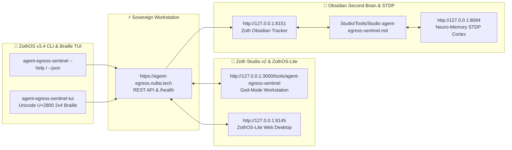

<div align="center">
  
</div>

<br />

<div align="center">
  <a href="https://zoth.nullai.tech/tools/agent-egress-sentinel"></a>
  <a href="http://127.0.0.1:8095"></a>
  <a href="http://127.0.0.1:8195"></a>
  <a href="https://buy.stripe.com/3cIfZg27PdKo2D64Ocfw40X"></a>
</div>

# 🛡️ Agent Egress Sentinel

> **Autonomous Zero-Dependency Network Interceptor, Domain Classifier, and Kinetic Egress Radar for AI Agents and LLM Runtimes.**  
> *Engineered by 1nc0gn30 • NullAI ([@1nc0gn30](https://github.com/1nc0gn30)) • NullAI Platform*

---

## 🏛️ Architectural Overview

**Agent Egress Sentinel** is an official sovereign tool in the **[Zoth Studio v2](https://zoth.nullai.tech)** (72-Tool Matrix) and **[ZothOS Linux 3.3](https://zothos.nullai.tech)** ecosystem.

| Property | Specification |
| :--- | :--- |
| **Tool ID** | `agent-egress-sentinel` |
| **Category** | `Security & Network` |
| **Web Radar Port** | `http://127.0.0.1:8095` |
| **Proxy Tunnel Port** | `http://127.0.0.1:8195` |
| **Execution Mode** | Python Standard Library Server + Proxy Daemon |
| **Zoth Studio Route** | [`http://127.0.0.1:3000/tools/agent-egress-sentinel`](http://127.0.0.1:3000/tools/agent-egress-sentinel) |
| **License** | **100% Free & Open Access (Zero Paywalls)** |

---

## 💎 What It Does & How It Works

- **Zero-Dependency Python Standard Library**: Operates completely out-of-the-box using standard `socket`, `select`, `sqlite3`, `http.server`, and `threading`. Zero external `pip` dependencies.
- **In-Memory TLS ClientHello SNI Extractor**: Sniffs destination hostnames directly from the initial TLS handshake without breaking SSL certificate chains or requiring self-signed root cert installations.
- **Kinetic Orbital Radar Dashboard**: Real-time concentric visual radar mapping destinations across LLM APIs, Model Hubs, Telemetry Sinks, Search Engines, and Local loopback services.
- **Autonomous Rules & Kernel Quarantine**:
  - `ALLOW_ALL`: Monitor and trace all agent outbound requests in real time.
  - `BLOCK_TELEMETRY`: Blackhole tracking pings (Segment, PostHog, Sentry, Datadog) while allowing model inference.
  - `ZERO_EGRESS`: Strict air-gap mode isolating all egress except localhost/127.0.0.1.
  - `ALLOWLIST_ONLY`: Restrict outbound connections strictly to verified domains.
- **Compliance HAR 1.2 & OpenAPI Exporter**: Generates standard HTTP Archive (HAR 1.2) traces and synthesized OpenAPI 3.0 specs of agent-discovered endpoints.

---

## 🛠️ ZothOS CLI & Daemon Commands

The CLI is pre-installed in `/usr/local/bin/agent-egress-sentinel` (aliased as `agent-egress`):

```bash
# Check daemon health & ZothOS integration status
agent-egress --status

# Print current session statistics & observed domains
agent-egress stats

# Run an arbitrary agent script under sentinel proxy supervision
agent-egress run python3 my_agent.py

# Export network traffic trace to HAR 1.2 format
agent-egress export agent-traffic.har

# Synthesize discovered endpoints into OpenAPI 3.0 specification
agent-egress openapi openapi-spec.json

# Clear historical database and traffic events
agent-egress clear

# Start radar web UI (:8095) and proxy tunnel (:8195)
agent-egress serve --web-port 8095 --proxy-port 8195
```

---

## ☕ Support 1nc0gn30 • NullAI (Zero Paywalls)

All tools across the Zoth Studio ecosystem are 100% free, unlocked, and open-source by default. If this utility provides value to your workflow, support development via:

- **Stripe "Buy Us a Coffee"**: [https://buy.stripe.com/3cIfZg27PdKo2D64Ocfw40X](https://buy.stripe.com/3cIfZg27PdKo2D64Ocfw40X)
- **Solana Tip Address**: `GG2eQbVh8ut1BK6j1A2tz7pSySdLpD38BgyEhGcxdXoK`

---

<div align="center">
  <sub>Engineered by <b>1nc0gn30 • NullAI</b> (<a href="https://github.com/1nc0gn30">@1nc0gn30</a>) &bull; <a href="https://nullai.tech">NullAI Platform</a> &bull; <a href="https://zoth.nullai.tech">Zoth Studio v2</a></sub>
</div>

---

## 🏛️ ZothOS v3.4, Zoth Studio v2 & Obsidian Second Brain Ecosystem



### Cross-Surface Integration Matrix

| Surface | Endpoint / Binary | Capabilities |
| :--- | :--- | :--- |
| **Standalone Workstation** | `https://agent-egress.nullai.tech` | 100% Free & Open-Access Web Deck, live `/health` & REST telemetry |
| **Zoth Studio v2 Route** | `http://127.0.0.1:3000/tools/agent-egress-sentinel` | Interactive God-Mode component inside Zoth Studio (`https://zoth.nullai.tech`) |
| **ZothOS v3.4 CLI & TUI** | `agent-egress-sentinel` / `agent-egress-sentinel-tui` | Global binary in `/usr/local/bin/` with Unicode `U+2800` Braille TUI & `--json` output |
| **ZothOS-Lite Web Desktop** | `http://127.0.0.1:8145` | Browser-native KDE-style window manager & terminal launcher |
| **Zoth Obsidian Tracker** | `http://127.0.0.1:8151` | Interactive Obsidian Second Brain vault explorer (`~/Documents/Obsidian Vault/Studio/Tools/Studio agent-egress-sentinel.md`) |
| **Neuro-Memory STDP Cortex** | `http://127.0.0.1:8094` | 3-Factor STDP synaptic memory daemon & 21-tool MCP server |

```bash
# Inspect CLI & Unicode U+2800 Braille TUI on ZothOS v3.4
agent-egress-sentinel --help
agent-egress-sentinel-tui --status
agent-egress-sentinel-tui --json

# Verify Second Brain Vault & 12-Step Verification Gallery on :8151
zoth-obsidian-tracker --verify
```

